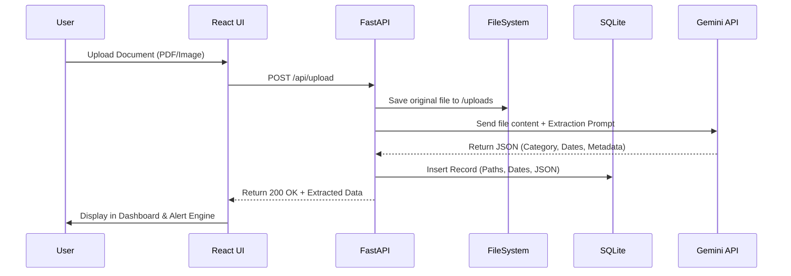

# Digital Filing Assistant - Architecture

## System Overview
The application follows a standard Client-Server architecture, utilizing a lightweight, fast Python backend and a modern React frontend.

## Data Flow & Architecture Diagram

## 1. Frontend (Client)
*   **Framework:** React JS (Vite)
*   **Styling:** Vanilla CSS (Modern, premium design system)
*   **Responsibilities:**
    *   File upload interface (Drag and drop support).
    *   Dashboard for viewing categorised documents.
    *   Alerts panel for upcoming expirations.
    *   Communicating with the FastAPI backend via RESTful endpoints.

## 2. Backend (Server)
*   **Framework:** Python FastAPI
*   **Responsibilities:**
    *   File I/O operations (saving user documents).
    *   Orchestrating calls to the AI model.
    *   Parsing and validating AI JSON output.
    *   Serving API endpoints.

## 3. Database & Storage
*   **Database:** SQLite (`database.db`) managed via SQLAlchemy. Chosen because it requires no separate server process and fits perfectly with the local-first requirement.
*   **File Storage:** Local Directory (`/backend/uploads/`).

## 4. AI Service Layer
*   **Service:** Online API (Google Gemini 1.5 Flash - Free Tier).
*   **Workflow:**
    1. Backend sends document content + System Prompt to AI.
    2. System Prompt strictly enforces a structured JSON response schema.
    3. Backend receives JSON, validates it against a Pydantic model, and inserts it into SQLite.
